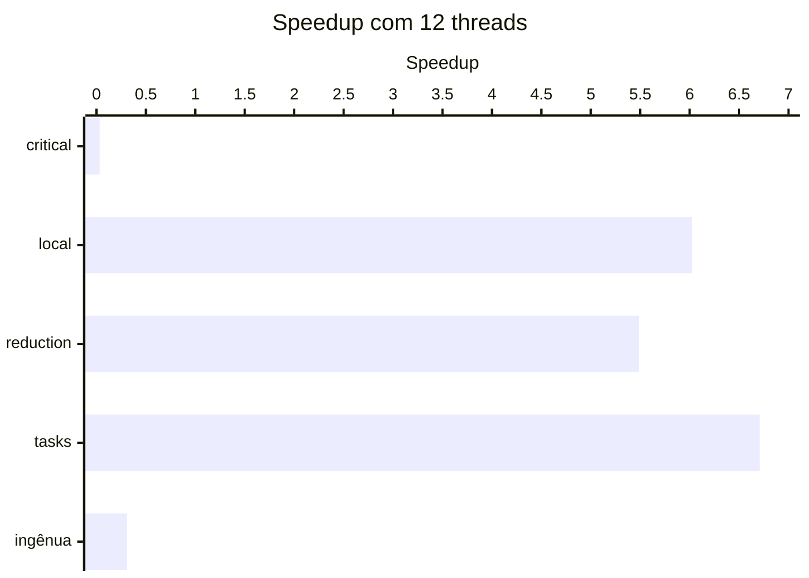

# Medições do desafio OpenMP em ambiente nativo e em Apptainer

Entre as versões que reproduziram o histograma serial, a configuração mais rápida foi `tasks` com **12 threads**. A mediana foi **0,206896 s**, contra **1,388007 s** na versão serial. O speedup foi de **6,71×** e a eficiência de **55,9%**.

## Ambiente e método

- Usei um Intel Core i7-1255U com 10 núcleos físicos e 12 CPUs lógicas, conforme o `nproc`. O sistema era Ubuntu 26.04.1 LTS, com kernel 7.0.0-42-generic e arquitetura x86_64.
- Compilei com GCC 15.2.0 e as flags do Makefile (`-std=c99 -Wall -Wextra -Wpedantic -O2 -fopenmp`).
- Usei `entradas/grande.txt` (256 MiB). Os três textos passaram na verificação SHA-256 de `entradas.sha256`. O programa cronometra `make_hist()` com `omp_get_wtime()`, entre a leitura e a impressão. Esse tempo inclui o `strlen` da entrada.
- Rodei cada configuração cinco vezes, uma de cada vez, alternando a ordem entre as rodadas. Na série principal, usei 1, 2, 4, 8 e 12 threads com `OMP_NUM_THREADS`, `OMP_DYNAMIC=FALSE` e afinidade padrão. Também rodei a serial cinco vezes.
- Comparei o histograma completo com o da serial na entrada média (64 MiB) e em todas as execuções da entrada grande. O programa também confere internamente o total. Na entrada grande, a serial contou 228.680.073 letras.
- Para calcular o speedup, dividi a mediana da serial pela mediana de cada configuração. A eficiência é o speedup dividido pelo número de threads, em porcentagem.

Exemplo de comando para uma medição com oito threads.

```bash
OMP_DYNAMIC=FALSE OMP_NUM_THREADS=8 ./omp-letters-reduction < entradas/grande.txt > /dev/null
```

## Tempos e desempenho

| Versão | Threads | Tempos das cinco rodadas (s) | Mediana (s) | Speedup | Eficiência | Saídas idênticas à serial |
|---|---:|---|---:|---:|---:|---:|
| serial | 1 | 1,381870 / 1,426093 / 1,388007 / 1,392785 / 1,387540 | 1,388007 | 1,00× | n/a | referência |
| `critical` | 1 | 5,336965 / 5,322787 / 5,273956 / 5,318183 / 5,278384 | 5,318183 | 0,26× | 26,1% | 5/5 |
| `critical` | 2 | 21,112600 / 21,569103 / 19,637524 / 17,995353 / 20,694420 | 20,694420 | 0,07× | 3,4% | 5/5 |
| `critical` | 4 | 24,644681 / 23,670496 / 25,118409 / 25,768903 / 25,723156 | 25,118409 | 0,06× | 1,4% | 5/5 |
| `critical` | 8 | 40,755744 / 40,694269 / 42,374040 / 42,226083 / 40,746847 | 40,755744 | 0,03× | 0,4% | 5/5 |
| `critical` | 12 | 42,461013 / 40,021181 / 42,815922 / 43,288892 / 42,187324 | 42,461013 | 0,03× | 0,3% | 5/5 |
| `local` | 1 | 1,462226 / 1,484841 / 1,646377 / 1,444599 / 1,439251 | 1,462226 | 0,95× | 94,9% | 5/5 |
| `local` | 2 | 0,813284 / 0,757949 / 0,754261 / 0,843284 / 0,842770 | 0,813284 | 1,71× | 85,3% | 5/5 |
| `local` | 4 | 0,526038 / 0,508980 / 0,488923 / 0,512043 / 0,487281 | 0,508980 | 2,73× | 68,2% | 5/5 |
| `local` | 8 | 0,273199 / 0,272228 / 0,280676 / 0,271104 / 0,273994 | 0,273199 | 5,08× | 63,5% | 5/5 |
| `local` | 12 | 0,229011 / 0,262714 / 0,230413 / 0,247480 / 0,219520 | 0,230413 | 6,02× | 50,2% | 5/5 |
| `reduction` | 1 | 1,438299 / 1,436362 / 1,432223 / 1,455763 / 1,441471 | 1,438299 | 0,97× | 96,5% | 5/5 |
| `reduction` | 2 | 0,738201 / 0,748344 / 0,740751 / 0,738337 / 0,771315 | 0,740751 | 1,87× | 93,7% | 5/5 |
| `reduction` | 4 | 0,498621 / 0,501650 / 0,479131 / 0,497798 / 0,479107 | 0,497798 | 2,79× | 69,7% | 5/5 |
| `reduction` | 8 | 0,272218 / 0,272752 / 0,271228 / 0,276041 / 0,279263 | 0,272752 | 5,09× | 63,6% | 5/5 |
| `reduction` | 12 | 0,244322 / 0,243020 / 0,264031 / 0,252906 / 0,266509 | 0,252906 | 5,49× | 45,7% | 5/5 |
| `tasks` | 1 | 1,410215 / 1,383000 / 1,380670 / 1,398453 / 1,391143 | 1,391143 | 1,00× | 99,8% | 5/5 |
| `tasks` | 2 | 0,708067 / 0,708424 / 0,705760 / 0,734890 / 0,707111 | 0,708067 | 1,96× | 98,0% | 5/5 |
| `tasks` | 4 | 0,450413 / 0,433199 / 0,433094 / 0,434388 / 0,432341 | 0,433199 | 3,20× | 80,1% | 5/5 |
| `tasks` | 8 | 0,249011 / 0,250167 / 0,249459 / 0,252277 / 0,269314 | 0,250167 | 5,55× | 69,4% | 5/5 |
| `tasks` | 12 | 0,206896 / 0,196382 / 0,195078 / 0,210474 / 0,212995 | 0,206896 | 6,71× | 55,9% | 5/5 |
| ingênua | 1 | 1,458500 / 1,454633 / 1,458890 / 1,456778 / 1,447802 | 1,456778 | 0,95× | 95,3% | 5/5 |
| ingênua | 2 | 2,658946 / 2,971847 / 2,509308 / 2,215726 / 2,681129 | 2,658946 | 0,52× | 26,1% | 0/5 |
| ingênua | 4 | 3,868067 / 4,002353 / 3,520520 / 3,572800 / 3,659031 | 3,659031 | 0,38× | 9,5% | 0/5 |
| ingênua | 8 | 4,079671 / 4,946244 / 4,410147 / 4,075988 / 4,835075 | 4,410147 | 0,31× | 3,9% | 0/5 |
| ingênua | 12 | 4,328067 / 4,621351 / 4,786239 / 4,495514 / 4,092355 | 4,495514 | 0,31× | 2,6% | 0/5 |

Na ingênua, os números de speedup e eficiência com saída divergente são apenas razões entre tempos. A perda de atualizações invalida a contagem.

### Speedup e eficiência de `tasks`

```mermaid
xychart-beta
    title "Speedup de tasks"
    x-axis "Threads" ["1", "2", "4", "8", "12"]
    y-axis "Speedup" 0 --> 7
    line [0.998, 1.960, 3.204, 5.548, 6.709]
```

```mermaid
xychart-beta
    title "Eficiência de tasks (%)"
    x-axis "Threads" ["1", "2", "4", "8", "12"]
    y-axis "Eficiência (%)" 0 --> 100
    line [99.775, 98.014, 80.102, 69.354, 55.906]
```

### Comparação com 12 threads

A barra da ingênua representa a razão entre tempos de uma contagem que divergiu da serial.



## Experimentos adicionais

As variações de `schedule` usam o mesmo código de `reduction` e oito threads. No teste de afinidade, as duas configurações usam dez threads e `OMP_PLACES=threads` com `OMP_PROC_BIND=spread`. Os dois conjuntos de CPUs incluem ambos os núcleos com SMT. O conjunto de oito núcleos usa os dois contextos de cada um deles e seis dos demais núcleos.

| Experimento | Threads | Tempos das cinco rodadas (s) | Mediana (s) |
|---|---:|---|---:|
| `reduction` com escalonamento padrão | 8 | 0,272218 / 0,272752 / 0,271228 / 0,276041 / 0,279263 | 0,272752 |
| `reduction` com `schedule(dynamic, 1)` | 8 | 13,949941 / 14,492966 / 14,335243 / 14,350237 / 14,372257 | 14,350237 |
| `reduction` com `schedule(dynamic, 4096)` | 8 | 0,258556 / 0,294951 / 0,254188 / 0,257946 / 0,260843 | 0,258556 |
| `reduction` em 10 núcleos físicos (CPUs 0, 2 e 4 a 11) | 10 | 0,226495 / 0,259417 / 0,225995 / 0,227455 / 0,224278 | 0,226495 |
| `reduction` em 8 núcleos físicos (CPUs 0 a 9) | 10 | 0,225062 / 0,224390 / 0,223116 / 0,224220 / 0,233109 | 0,224390 |

## Análise

- **Ingênua.** A versão foi mais lenta em todas as configurações com mais de uma thread. As threads disputam os contadores compartilhados e podem perder incrementos. Com oito threads, a primeira execução imprimiu 100.084.000 letras, quando o esperado era 228.680.073. A verificação interna retornou erro em 20 das 25 execuções.
- **`critical`.** O histograma bateu com o da serial. Com oito threads, a mediana foi de 40,756 s, contra 1,388 s na serial. A cada letra, as threads precisam esperar a vez de atualizar os contadores na mesma região crítica. Essa espera aumenta o tempo de execução.
- **Escalonamento.** Com oito threads, `dynamic,1` levou 14,350 s e `dynamic,4096` levou 0,259 s, frente a 0,273 s no padrão. Distribuir uma iteração de cada vez aumenta a frequência de pedidos de trabalho ao runtime.
- **Escalabilidade.** `local`, `reduction` e `tasks` tiveram seu maior speedup com 12 threads, o maior valor testado na série principal. Testei a hipótese de benefício ao distribuir dez threads por dez núcleos físicos. A mediana em oito núcleos foi 0,9% menor. Os intervalos dos tempos das duas configurações se sobrepuseram, e esse teste ficou inconclusivo. Ao mudar a afinidade, também variam os núcleos sem SMT disponíveis para o teste. Frequência e carga de fundo ficaram a cargo do sistema.
- **`tasks` frente a `reduction`.** A versão com tarefas foi mais rápida com 1, 2, 4, 8 e 12 threads. Com 12 threads, as medianas foram 0,206896 s e 0,252906 s. As tarefas de 64 KiB podem redistribuir trabalho entre threads que terminam em ritmos diferentes. Criar tarefas e entrar na região crítica a cada bloco também tem custo. Os dados mostram o efeito combinado desses fatores.
- **Uma thread.** A mediana de `reduction` com uma thread foi 1,438299 s frente a 1,388007 s na serial. Essa comparação inclui o custo de entrar na região paralela e combinar os contadores privados.

## Medições em Apptainer

A versão correta mais rápida foi `tasks` com **12 threads**. A mediana foi **0,190940 s**, contra **1,405767 s** na serial do contêiner. O speedup foi **7,36×** e a eficiência **61,4%**.

- Usei o Apptainer 1.5.5 com a imagem `hist.sif`, gerada pela receita `hist.def`. Dentro do contêiner, usei Ubuntu 24.04.5 LTS e GCC 13.3.0 (pacote 13.3.0-6ubuntu2~24.04.1).
- Rodei cada configuração cinco vezes, uma de cada vez, com a mesma entrada de 256 MiB verificada por SHA-256 e as flags do Makefile. Medi o tempo de `make_hist()` e usei a versão serial do contêiner como referência para o speedup e a eficiência.
- Comparei a saída de cada rodada com a da serial, que contou 228.680.073 letras.

| Versão | Threads | Tempos das cinco rodadas (s) | Mediana (s) | Speedup | Eficiência | Histograma correto | Nativo (s) | Variação vs. nativo |
|---|---:|---|---:|---:|---:|---:|---:|---:|
| serial | 1 | 1,594933 / 1,405767 / 1,399661 / 1,379346 / 1,468408 | 1,405767 | 1,00× | 100,0% | 5/5 | 1,388007 | +1,3% |
| critical | 1 | 5,674020 / 5,305149 / 5,301418 / 5,297259 / 5,315398 | 5,305149 | 0,26× | 26,5% | 5/5 | 5,318183 | -0,2% |
| critical | 2 | 23,391043 / 19,212326 / 21,670709 / 19,903279 / 21,175880 | 21,175880 | 0,07× | 3,3% | 5/5 | 20,694420 | +2,3% |
| critical | 4 | 25,791020 / 24,725825 / 24,794787 / 23,963787 / 24,148466 | 24,725825 | 0,06× | 1,4% | 5/5 | 25,118409 | -1,6% |
| critical | 8 | 41,578620 / 39,958301 / 43,007399 / 43,048165 / 42,419666 | 42,419666 | 0,03× | 0,4% | 5/5 | 40,755744 | +4,1% |
| critical | 12 | 39,630649 / 42,289494 / 41,263056 / 40,539431 / 41,403776 | 41,263056 | 0,03× | 0,3% | 5/5 | 42,461013 | -2,8% |
| local | 1 | 2,158200 / 1,466860 / 1,466098 / 1,499136 / 1,465440 | 1,466860 | 0,96× | 95,8% | 5/5 | 1,462226 | +0,3% |
| local | 2 | 0,771655 / 0,745599 / 0,770816 / 0,751442 / 0,747887 | 0,751442 | 1,87× | 93,5% | 5/5 | 0,813284 | -7,6% |
| local | 4 | 0,534620 / 0,537251 / 0,509923 / 0,510382 / 0,524713 | 0,524713 | 2,68× | 67,0% | 5/5 | 0,508980 | +3,1% |
| local | 8 | 0,298421 / 0,297554 / 0,292784 / 0,300264 / 0,291746 | 0,297554 | 4,72× | 59,1% | 5/5 | 0,273199 | +8,9% |
| local | 12 | 0,302463 / 0,205569 / 0,215966 / 0,257804 / 0,260306 | 0,257804 | 5,45× | 45,4% | 5/5 | 0,230413 | +11,9% |
| reduction | 1 | 1,475727 / 1,483634 / 1,474932 / 1,490159 / 1,481066 | 1,481066 | 0,95× | 94,9% | 5/5 | 1,438299 | +3,0% |
| reduction | 2 | 0,818393 / 0,757559 / 0,785791 / 0,759841 / 0,765582 | 0,765582 | 1,84× | 91,8% | 5/5 | 0,740751 | +3,4% |
| reduction | 4 | 0,572328 / 0,511677 / 0,506938 / 0,508151 / 0,525799 | 0,511677 | 2,75× | 68,7% | 5/5 | 0,497798 | +2,8% |
| reduction | 8 | 0,321553 / 0,318248 / 0,327864 / 0,287639 / 0,323275 | 0,321553 | 4,37× | 54,6% | 5/5 | 0,272752 | +17,9% |
| reduction | 12 | 0,299193 / 0,199698 / 0,213816 / 0,260066 / 0,290718 | 0,260066 | 5,41× | 45,0% | 5/5 | 0,252906 | +2,8% |
| tasks | 1 | 1,394488 / 1,463911 / 1,386926 / 1,638192 / 1,383458 | 1,394488 | 1,01× | 100,8% | 5/5 | 1,391143 | +0,2% |
| tasks | 2 | 0,727159 / 0,716539 / 0,707788 / 0,721068 / 0,718654 | 0,718654 | 1,96× | 97,8% | 5/5 | 0,708067 | +1,5% |
| tasks | 4 | 0,417895 / 0,427911 / 0,428766 / 0,425864 / 0,443411 | 0,427911 | 3,29× | 82,1% | 5/5 | 0,433199 | -1,2% |
| tasks | 8 | 0,240819 / 0,238678 / 0,240853 / 0,238087 / 0,254726 | 0,240819 | 5,84× | 73,0% | 5/5 | 0,250167 | -3,7% |
| tasks | 12 | 0,201962 / 0,190940 / 0,179497 / 0,180023 / 0,191964 | 0,190940 | 7,36× | 61,4% | 5/5 | 0,206896 | -7,7% |
| ingênua | 1 | 1,430754 / 1,432754 / 1,414013 / 1,416782 / 1,439566 | 1,430754 | 0,98× | 98,3% | 5/5 | 1,456778 | -1,8% |
| ingênua | 2 | 2,365616 / 3,369042 / 2,265320 / 2,483666 / 3,548089 | 2,483666 | 0,57× | 28,3% | 0/5 | 2,658946 | -6,6% |
| ingênua | 4 | 3,718399 / 3,326956 / 3,717911 / 3,269402 / 4,201458 | 3,717911 | 0,38× | 9,5% | 0/5 | 3,659031 | +1,6% |
| ingênua | 8 | 4,578788 / 4,994205 / 5,041757 / 5,007018 / 4,893407 | 4,994205 | 0,28× | 3,5% | 0/5 | 4,410147 | +13,2% |
| ingênua | 12 | 5,037127 / 4,455338 / 4,526258 / 5,009637 / 4,922077 | 4,922077 | 0,29× | 2,4% | 0/5 | 4,495514 | +9,5% |

Uma variação positiva indica mais tempo em Apptainer. Quando a ingênua diverge, as razões de tempo descrevem uma execução com contagem incorreta.

### Comparação com as medições nativas

Para `tasks` com 12 threads, a mediana foi 0,206896 s no nativo e 0,190940 s em Apptainer.

A comparação usa a mesma máquina, entradas e flags. A versão do compilador, as bibliotecas do ambiente e a carga do sistema também podem influenciar a diferença de tempo.

```mermaid
xychart-beta
    title "Speedup de tasks em Apptainer"
    x-axis "Threads" ["1", "2", "4", "8", "12"]
    y-axis "Speedup" 0 --> 8
    line [1.008, 1.956, 3.285, 5.837, 7.362]
```

## Respostas

1. **A versão ingênua foi mais rápida ou mais lenta que a serial? Por quê?**

   Foi mais lenta em todas as configurações com mais de uma thread. Com 8 threads, levou 4,410 s, contra 1,388 s na serial. As threads disputavam os mesmos contadores e podiam sobrescrever incrementos umas das outras. Na primeira rodada com 8 threads, a ingênua contou 100.084.000 letras, de um total esperado de 228.680.073.

2. **Como o tempo de `critical` se compara ao da serial? Por quê?**

   O histograma bateu com o da serial, mas a execução ficou mais lenta. Com 8 threads, a mediana foi de 40,756 s, contra 1,388 s na serial. Só uma thread pode atualizar os contadores dentro da região crítica por vez, e essa espera se repete a cada letra.

3. **O que aconteceu com `schedule(dynamic, 1)`? E com blocos maiores?**

   Com 8 threads, `reduction` levou 14,350 s com blocos de 1 iteração e 0,259 s com blocos de 4.096. O escalonamento padrão levou 0,273 s. Com blocos pequenos, as threads precisam pedir trabalho com mais frequência. Com blocos maiores, cada pedido já entrega mais iterações.

4. **Até quantas threads o speedup cresceu? Que hipótese testei?**

   Em `local`, `reduction` e `tasks`, o speedup cresceu até 12 threads, o maior valor testado. Testei se distribuir 10 threads por 10 núcleos físicos seria melhor que usar 8 núcleos. A mediana com 8 núcleos foi 0,9% menor, mas os intervalos dos tempos se sobrepuseram. O teste ficou inconclusivo.

   Com uma thread, `reduction` levou 1,438299 s, contra 1,388007 s na serial. Essa diferença inclui o custo de entrar na região paralela e combinar os contadores privados.

5. **A versão `tasks` foi mais rápida ou mais lenta que `reduction`? Por quê?**

   Foi mais rápida em todas as configurações testadas. Com 12 threads, `tasks` levou 0,206896 s e `reduction` levou 0,252906 s. Uma explicação possível é que as threads que terminam um bloco de 64 KiB podem pegar outro, o que ajuda a redistribuir o trabalho. Criar e combinar as tarefas também tem um custo.